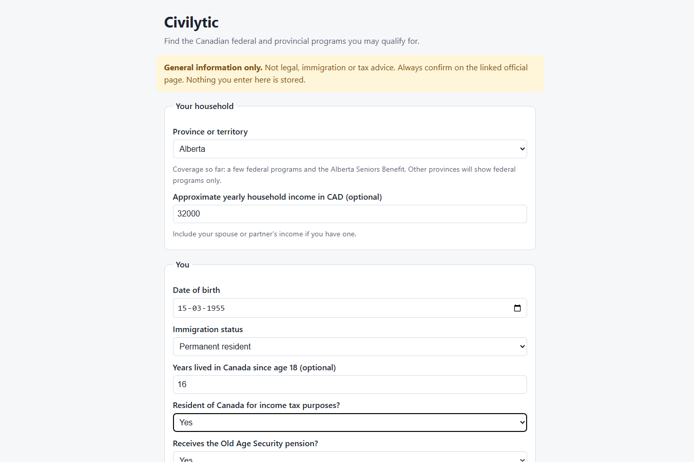
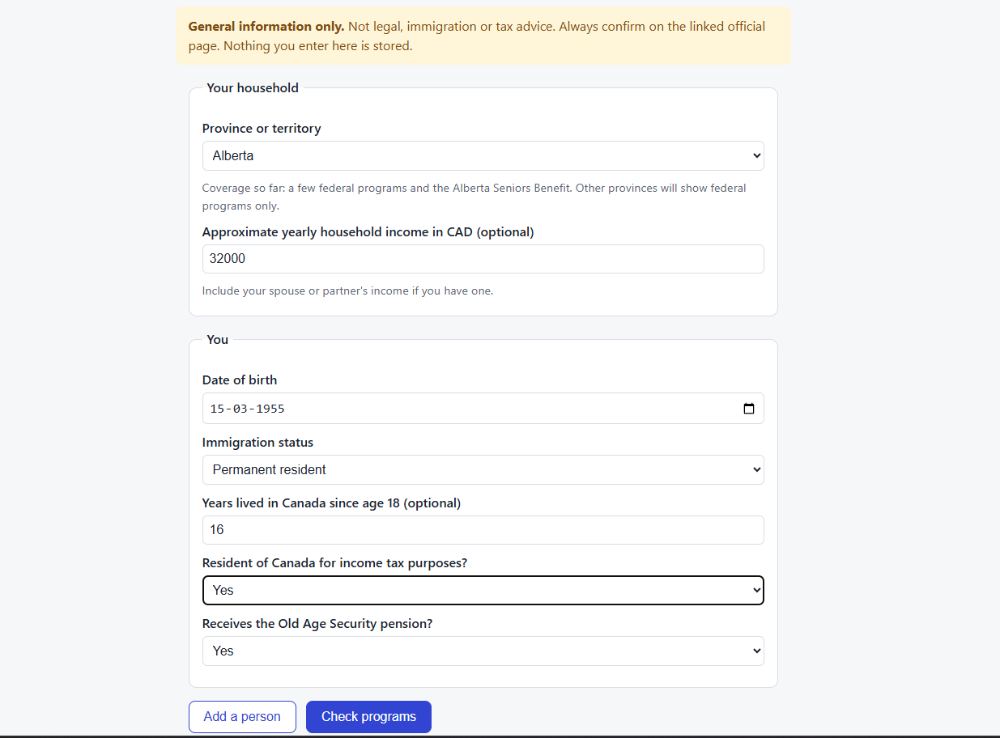
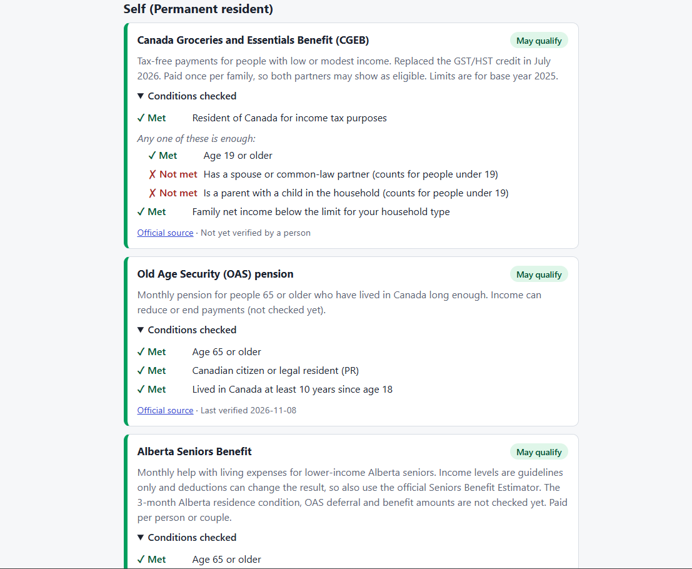
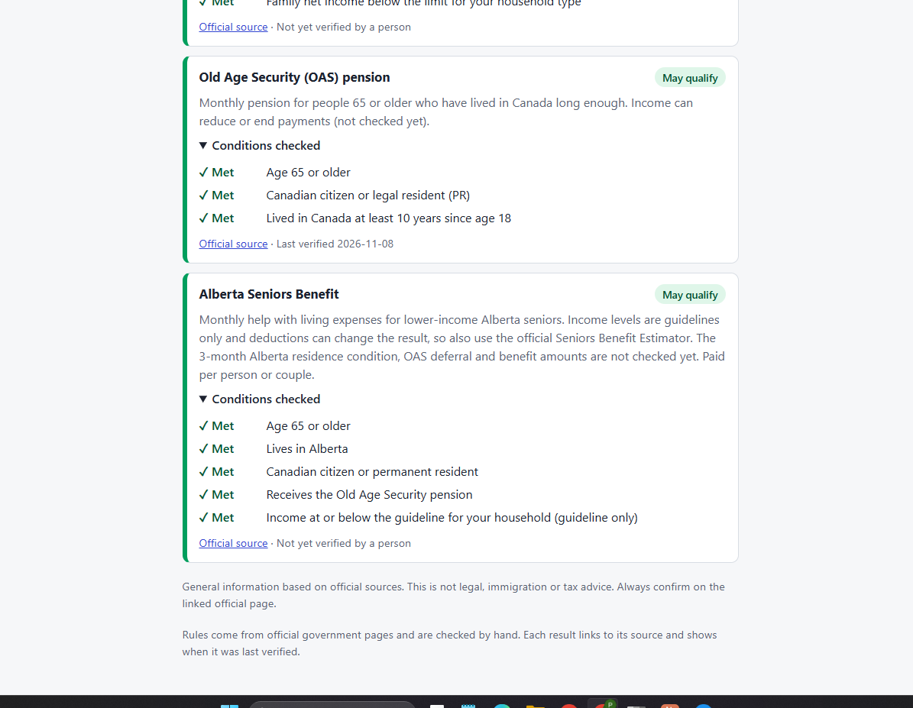

# Civilytic


A privacy-first tool that helps people in Canada see which government
programs they **may** qualify for, based on their household, immigration
status and province.

## Screenshots

All data shown is fictional, and nothing entered on the page is stored.

**Enter a household**





**See each program, every condition checked, and the official source**




> **Important:** Civilytic provides general information based on official
> sources. It is not legal, immigration or tax advice. Always confirm
> eligibility on the linked official page. The screenshot uses fictional data.

## Why it exists

Government benefits in Canada are spread across federal, provincial and
territorial sites, each with its own rules, and the rules change. Civilytic
brings them into one place and shows its sources.

## How it works

Eligibility is decided by **plain, testable code**, not by an AI model.

- **Rules are data.** Each program stores its conditions as structured rules
  (field, operator, value), plus a source link and a last-verified date.
- **Three-way results.** Each rule is `met`, `not_met` or `unknown` (missing
  information). A program is `may_qualify`, `does_not_qualify` or
  `needs_info`. The app never guesses: missing facts produce `needs_info`.
- **Alternatives and lookups.** Rules can be grouped as "any one of these is
  enough", and income limits can be looked up by household type.
- **Province-aware.** A household is checked against federal programs plus its
  own province's programs. Adding a province means adding data, not code.
- **Household model.** Each person has their own status, birth date and
  residence history. Partner and children are derived from the household.
- **Stateless by design.** The web page sends the household to
  `POST /api/check/`, which evaluates it in memory and stores nothing.

## Programs covered so far

| Program | Level | Source |
|---|---|---|
| Old Age Security (OAS) pension | Federal | canada.ca |
| Canada Groceries and Essentials Benefit (CGEB) | Federal | canada.ca |
| Alberta Seniors Benefit | Alberta | alberta.ca |

Every program links to its official source and carries a last-verified date.
Rules are checked by hand against the official page before they are added.

## Known limitations

- Only a few programs are covered. Provinces other than Alberta show federal
  programs only. The app says so instead of guessing.
- Benefit **amounts** are not calculated.
- Income checks use a rough household income. CGEB uses *adjusted family net
  income* and Alberta Seniors Benefit income levels are *guidelines only*, so
  results near a limit should be confirmed with the official tools.
- Not yet checked: the 3-month Alberta residence condition and OAS deferral
  for the Alberta Seniors Benefit.

## Quick start

Requires Docker.

```
git clone <repository-url>
cd Civilytic
cp .env.example .env        # Windows (cmd): copy .env.example .env
docker compose up -d --build
docker compose exec web python manage.py migrate
docker compose exec web python manage.py load_jurisdictions
docker compose exec web python manage.py load_programs
docker compose exec web python manage.py load_demo_data
```

The `.env.example` values are for local use only. Replace them if you ever
run this anywhere public.

Then open http://localhost:8000/ and try a household. The demo command also
prints IDs of fictional households you can inspect from the command line:

```
docker compose exec web python manage.py evaluate_household <id>
```

## Run the tests

```
docker compose exec web python manage.py test benefits
```

## API

| Endpoint | Access | Description |
|---|---|---|
| `GET /api/programs/` | Public | List of programs with source links |
| `POST /api/check/` | Public, rate-limited | Evaluate a household sent in the request. Nothing is stored. |
| `GET /api/households/<id>/results/` | Owner only | Results for a saved household |

An example request is in [`docs/example-request.json`](docs/example-request.json):

```
curl -X POST http://localhost:8000/api/check/ -H "Content-Type: application/json" --data-binary @docs/example-request.json
```

## Project layout

```
benefits/     rules engine, program data, API and web page
households/   household and person models
config/       Django settings
docs/         example request and screenshot
```

## Roadmap

- [ ] More federal and Alberta programs, then more provinces
- [ ] Document upload with OCR and AI field extraction
- [ ] Plain-language explanations and cited answers (retrieval + LLM)
- [ ] Scheduled checks for changes on official pages
- [ ] Evaluation results (accuracy of extraction and answers)

## Tech stack

Python, Django, Django REST Framework, PostgreSQL, Docker, WhiteNoise,
Gunicorn. Plain HTML, CSS and JavaScript for the front end.

## License

MIT